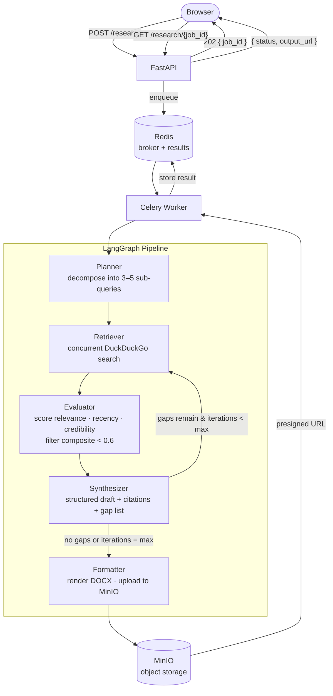

# Ardia — Autonomous Research Agent

Submit a natural-language question and receive a fully cited, formatted DOCX report. Ardia is not a chatbot — it runs a multi-stage agentic pipeline that plans, searches, evaluates evidence, and iteratively refines its output before rendering a document.

## Why Ardia?

| | Chatbot | Ardia |
|---|---|---|
| Output | Chat reply | Downloadable DOCX report |
| Sources | Hallucinated or missing | Every claim cited, full bibliography |
| Research depth | Single LLM call | Multi-stage pipeline with iterative gap-filling |
| Source quality | Unknown | Scored on relevance, recency, and credibility |
| Long jobs | Blocks the client | Async queue — API returns immediately |

### Key features

- **Self-refining gap loop** — after synthesis, the agent identifies unanswered sub-questions and loops back to retrieve more evidence, repeating until the report is complete or the depth limit is reached
- **Evidence-first output** — every factual claim carries an inline source URL; a deduplicated bibliography is appended to every report
- **3-dimensional quality filtering** — search results are scored on relevance, recency, and credibility; anything below a composite score of 0.6 is dropped before synthesis
- **Model-agnostic** — swap the LLM with two env vars (`LLM_MODEL`, `LLM_PROVIDER`); works with any HuggingFace Inference API model or third-party provider
- **Non-blocking jobs** — Celery + Redis queue; `POST /research` returns a `job_id` immediately, the client polls for completion
- **Configurable depth** — `quick` / `standard` / `deep` modes control how many refinement iterations run (1 / 2 / 3)
- **Real-time progress events** — each pipeline stage publishes structured events to Redis Pub/Sub as it runs
- **Rate-limit-safe search** — concurrent DuckDuckGo queries are bounded by a semaphore and staggered to avoid triggering blocks

## Architecture



### Pipeline stages

| Stage | What it does |
|---|---|
| **Planner** | Decomposes the question into 3–5 focused sub-queries, each tagged with an intent (`factual`, `comparative`, or `recent`) |
| **Retriever** | Searches DuckDuckGo concurrently for each sub-query with a per-query timeout and rate-limit backoff |
| **Evaluator** | Scores every result on relevance, recency, and credibility (each 0–1); filters out results with composite score < 0.6 |
| **Synthesizer** | Produces a structured `ReportDraft` with thematic sections, inline citations, and a list of knowledge gaps |
| **Formatter** | Renders the draft to DOCX via a Node.js subprocess, uploads to MinIO, returns a 1-hour presigned URL |

The synthesizer loops back to the retriever when gaps remain, up to the per-mode limit.

| Mode | Max iterations |
|---|---|
| `quick` | 1 |
| `standard` | 2 |
| `deep` | 3 |

## Tech stack

| Layer | Choice |
|---|---|
| Orchestration | LangGraph 0.2.x |
| LLM | Any HuggingFace Inference API model (configurable via env) |
| Web search | DuckDuckGo via LangChain Community |
| Document generation | `docx` npm package (Node.js subprocess) |
| Backend API | FastAPI + Python 3.12 |
| Async tasks | Celery 5 + Redis 7 |
| Object storage | MinIO (S3-compatible — swap to AWS S3 with one config change) |
| Tracing | LangSmith |
| Frontend | React 18 + Tailwind CSS |
| Infra | Docker Compose |

## Project layout

```
ardia/
├── backend/
│   ├── api/
│   │   ├── main.py          # FastAPI app — /research endpoints + /health
│   │   └── schemas.py       # ResearchRequest / ResearchResponse
│   ├── agent/
│   │   ├── graph.py         # LangGraph pipeline definition
│   │   ├── llm.py           # LangChain model factory (swap providers here)
│   │   ├── state.py         # AgentState TypedDict
│   │   ├── models.py        # Pydantic v2 data contracts
│   │   └── nodes/
│   │       ├── planner.py
│   │       ├── retriever.py
│   │       ├── evaluator.py
│   │       ├── synthesizer.py
│   │       └── formatter.py
│   ├── tasks.py             # Celery task wrapping graph.run()
│   ├── storage.py           # MinIO upload + presigned URL helpers
│   └── config.py            # pydantic-settings — all env vars
├── document-gen/
│   ├── generate.js          # Node.js DOCX builder
│   └── package.json
├── frontend/
│   └── src/
│       ├── App.jsx
│       ├── api.js
│       └── components/
│           ├── ResearchForm.jsx
│           ├── StatusPoller.jsx
│           └── ResultCard.jsx
├── docker-compose.yml
├── requirements.txt
└── .env.example
```

## Quick start

```bash
# 1. Copy and fill in your credentials
cp .env.example .env

# 2. Build and start all services
docker compose up --build

# 3. Open the frontend
#    http://localhost:5173

# 4. MinIO console (create/inspect buckets)
#    http://localhost:9001
```

Services started by Docker Compose:

| Service | Port | Description |
|---|---|---|
| `redis` | 6379 | Celery broker + result backend |
| `minio` | 9000 / 9001 | Object storage API / admin console |
| `minio-init` | — | One-shot container that creates the bucket |
| `api` | 8000 | FastAPI backend |
| `worker` | — | Celery worker (2 concurrent jobs) |
| `frontend` | 5173 | Vite dev server |

## Environment variables

Copy `.env.example` to `.env` and fill in the required values.

| Variable | Required | Default | Description |
|---|---|---|---|
| `HUGGINGFACE_API_KEY` | Yes | — | HuggingFace Inference API key |
| `LLM_MODEL` | No | `mistralai/Mistral-7B-Instruct-v0.3` | Any HF chat model repo ID |
| `LLM_PROVIDER` | No | — | HuggingFace Inference provider (e.g. `featherless-ai`, `together`). Unset to use HuggingFace's own infrastructure |
| `LANGSMITH_API_KEY` | Yes | — | LangSmith tracing key |
| `LANGSMITH_PROJECT` | No | `research-agent` | LangSmith project name |
| `MINIO_ENDPOINT` | No | `http://minio:9000` | Internal MinIO URL used by backend services |
| `MINIO_PUBLIC_ENDPOINT` | No | `http://localhost:9000` | Host-accessible MinIO URL embedded in presigned download links |
| `MINIO_ACCESS_KEY` | Yes | — | MinIO root user |
| `MINIO_SECRET_KEY` | Yes | — | MinIO root password |
| `MINIO_BUCKET` | No | `research-reports` | Bucket for report files |
| `REDIS_URL` | No | `redis://redis:6379/0` | Celery broker URL |
| `ENVIRONMENT` | No | `development` | Set to `production` to restrict CORS |
| `VITE_API_URL` | No | `http://localhost:8000` | Frontend → API base URL |

## Swapping the LLM

All LLM calls go through [`backend/agent/llm.py`](backend/agent/llm.py). To use a different model, set `LLM_MODEL` (and optionally `LLM_PROVIDER`) in your `.env`:

```bash
# Any model on HuggingFace's own infrastructure
LLM_MODEL=meta-llama/Llama-3.1-8B-Instruct

# Model served by a third-party provider
LLM_MODEL=Qwen/Qwen2.5-72B-Instruct
LLM_PROVIDER=featherless-ai
```

To switch to a completely different LLM backend (OpenAI, Ollama, Bedrock, etc.), replace `_HFChatModel` in [`backend/agent/llm.py`](backend/agent/llm.py) with the appropriate LangChain `BaseChatModel` subclass. No other files need to change.

## Swapping to AWS S3

MinIO and AWS S3 share the same API. To switch:

1. Remove `MINIO_*` vars; add `AWS_ACCESS_KEY_ID`, `AWS_SECRET_ACCESS_KEY`, `AWS_S3_BUCKET`, `AWS_REGION`.
2. In [`backend/storage.py`](backend/storage.py), remove `endpoint_url` from the client call and update the setting references.
3. Remove the `minio` and `minio-init` services from `docker-compose.yml`.

## API reference

### `POST /research`

Start a research job.

```json
// Request
{ "question": "What are the latest advances in fusion energy?", "mode": "standard" }

// Response 202
{ "job_id": "abc-123", "status": "queued" }
```

### `GET /research/{job_id}`

Poll job status.

```json
// Done
{ "job_id": "abc-123", "status": "done", "output_url": "http://localhost:9000/research-reports/..." }

// Failed
{ "job_id": "abc-123", "status": "failed", "error": "..." }
```

### `GET /health`

Returns `{"status": "ok"}`. Used by Docker Compose health checks.
